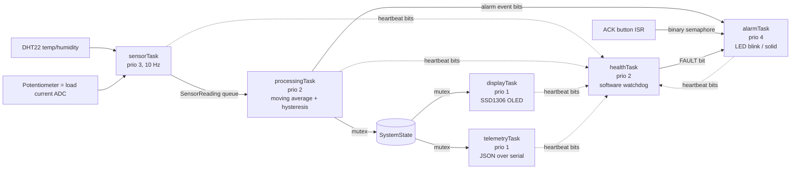

# FreeRTOS Multi-Task Sensor Monitor (ESP32)


A real-time monitoring system for the ESP32 built on **FreeRTOS**. Six concurrent tasks sample sensors, filter the data, detect alarm conditions with hysteresis, drive an operator alarm with acknowledgement, update an OLED display, stream JSON telemetry and run a software watchdog.

It runs on a real ESP32 or entirely in the free **[Wokwi](https://wokwi.com) simulator** (circuit included in `diagram.json`).

## Features

- **6 FreeRTOS tasks** pinned across both ESP32 cores with deliberate priorities
- **Queue** between producer (sensor) and consumer (processing) with drop counting, so the sampler never blocks
- **Mutexes** protecting shared system state and the serial port
- **Binary semaphore given from an ISR** (button) with debouncing done in task context
- **Event groups** for alarm flags and for task heartbeats
- **Software watchdog**: detects stalled tasks and raises a FAULT alarm
- **Deterministic timing** with `vTaskDelayUntil` (no drift)
- **Stack high-water mark and heap monitoring**
- **Hardware-independent signal processing** (moving average, hysteresis, ADC scaling), **unit-tested on the host with Unity**
- **GitHub Actions CI**: runs the unit tests and builds the ESP32 firmware on every push

## Architecture



| Task | Priority | Core | Period | Responsibility |
|---|---|---|---|---|
| `alarmTask` | 4 | 1 | 25 ms | Drives alarm LED: 4 Hz blink = new alarm, solid = acknowledged |
| `sensorTask` | 3 | 1 | 100 ms | Samples ADC (current) at 10 Hz and DHT22 every 2 s, pushes to queue |
| `processingTask` | 2 | 1 | event-driven | Filters data, applies hysteresis thresholds, sets alarm event bits |
| `healthTask` | 2 | 0 | 3 s | Checks heartbeats from every task, reports stack/heap usage |
| `displayTask` | 1 | 0 | 500 ms | Renders readings and alarm status on the OLED |
| `telemetryTask` | 1 | 0 | 1 s | Streams one JSON line per second over serial |

### Alarm behaviour

| Condition | Trigger | Clears at |
|---|---|---|
| High temperature | ≥ 30.0 °C (4-sample average) | ≤ 29.0 °C |
| High load current | ≥ 15.0 A (8-sample average) | ≤ 14.0 A |
| Task fault | any task misses its heartbeat for 3 s | heartbeats resume |

Pressing **ACK** acknowledges active alarms (LED goes from blinking to solid). The acknowledgement resets automatically when all alarms clear.

## Hardware / pin map

| Component | ESP32 pin |
|---|---|
| DHT22 data | GPIO 15 |
| Potentiometer (simulated current sensor) | GPIO 34 (ADC1) |
| SSD1306 OLED SDA / SCL | GPIO 21 / 22 |
| Alarm LED (220 Ω) | GPIO 4 |
| ACK push button (to GND) | GPIO 18 |

## Getting started

### Option 1: Build in the cloud (no install)
Every push runs GitHub Actions, which executes the unit tests and compiles the firmware. Check the **Actions** tab.

### Option 2: PlatformIO + Wokwi simulator in VS Code
1. Install the **PlatformIO IDE** and **Wokwi Simulator** extensions in VS Code.
2. Build: `pio run -e esp32dev`
3. Press `F1` → **Wokwi: Start Simulator** (uses `wokwi.toml` and `diagram.json`).
4. Click the DHT22 to change the temperature, turn the potentiometer to change the load current, and press **ACK** to acknowledge alarms. Watch the OLED, the LED and the serial monitor.

### Option 3: Real hardware
Wire the parts as in the pin map, then `pio run -e esp32dev -t upload` and `pio device monitor`.

### Run the unit tests
```bash
pio test -e native
```

## Telemetry format

One JSON object per line at 115200 baud:

```json
{"t_ms":12000,"temp_c":24.0,"hum_pct":45.0,"current_a":7.52,"alarm_temp":false,"alarm_current":false,"fault":false,"ack":false,"samples":118,"drops":0,"sensor_errors":0}
```

## Project structure

```
├── src/
│   ├── main.cpp              # RTOS object creation, ISR, task start-up
│   ├── app.h / app_config.h  # shared types, event bits, pins, priorities, thresholds
│   ├── sensor_task.cpp
│   ├── processing_task.cpp
│   ├── alarm_task.cpp
│   ├── display_task.cpp
│   ├── telemetry_task.cpp
│   └── health_task.cpp       # software watchdog + stack/heap stats
├── lib/signal_processing/    # hardware-independent, unit-tested logic
├── test/test_signal/         # Unity tests (run on host)
├── diagram.json / wokwi.toml # Wokwi simulation
└── .github/workflows/ci.yml  # CI: tests + firmware build
```

## Possible extensions
- Publish telemetry over Wi-Fi/MQTT to a Grafana dashboard
- Replace the software watchdog with the ESP32 hardware Task Watchdog Timer
- Add SD-card logging in a low-priority task

## License
MIT
